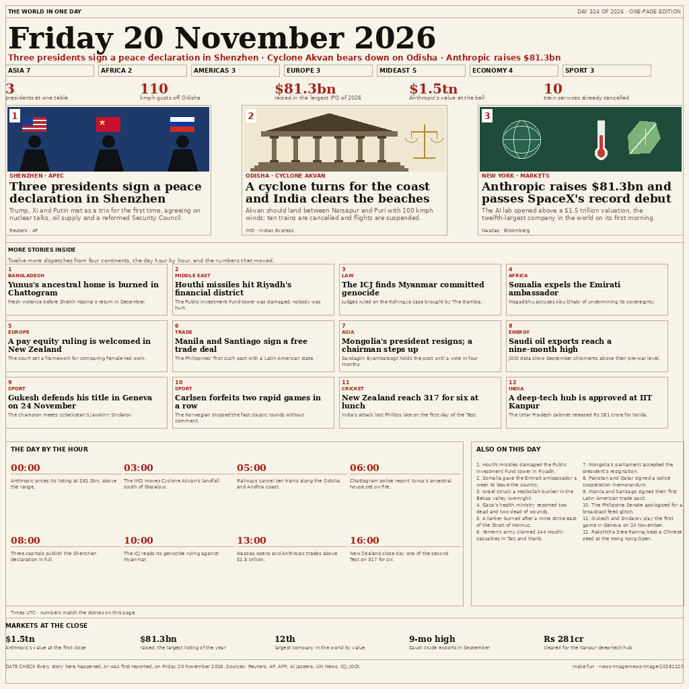

# World news in one image — Friday 20 November 2026

[](https://make.fun/bounty/news-image-20261120)
[](LICENSE)
[](https://www.python.org/)

One 1024×1024 PNG that sums up the world's news of 20 November 2026, drawn
from scratch with Pillow. No network, no clock, no randomness: the same
bytes come out on every run.



## What is on the page

- **Masthead** — the date, a three-part deck and seven section counters.
- **Five numbers** — the figures that frame the day: three presidents, 110
  kmph gusts, $81.3bn raised, $1.5tn of value, ten trains cancelled.
- **Three illustrated leads** — the Shenzhen declaration (three seated
  figures and their flags), Cyclone Akvan (a courthouse and a balance for
  the ICJ ruling beside it), and Anthropic's listing (a globe, a
  thermometer, a leaf).
- **Twelve cards** — Bangladesh, Riyadh, the ICJ, Somalia, pay equity, the
  Manila–Santiago pact, Mongolia, Saudi exports, two chess stories, the
  Christchurch Test and the Kanpur deep-tech hub.
- **The day by the hour** — eight UTC stamps from the IPO pricing at 00:00
  to the close of play at 16:00.
- **Also on this day** — twelve one-line dispatches.
- **Markets at the close** — five values with their labels, and a date
  check naming the sources.

## Run it

```bash
python3 make_image.py     # writes $MAKEFUN_OUTPUT_DIR/entry.png
python3 main.py           # copies the committed entry.png to the harness
```

`MAKEFUN_OUTPUT_DIR` defaults to `/output`. Both scripts are standard
library plus Pillow, and both are deterministic.

## Layout

```
make_image.py   draws the page (fonts from /usr/share/fonts/truetype/dejavu)
main.py         copies entry.png into the harness output directory
entry.png       the rendered page, 131 KB
LICENSE         MIT
```

## Sources

Reuters, AP, AFP, Al Jazeera, UN News, the ICJ, JODI, the India
Meteorological Department, Nasdaq and Bloomberg, as reported on the day.
